# DeskHub

DeskHub 是放在电脑桌上的一块圆角触摸屏，加上 Mac 菜单栏里的一个 App。

- **切源**：在触摸屏或菜单栏上点一个输入源，显示器就切过去。App 通过 DDC 直接给显示器发命令，再读回确认。
- **桌面时钟和状态**：触摸屏显示时间、日期、网络、电脑、电源和时间的状态，以及电池、亮度和连接。
- **AI 用量**：App 读这台 Mac 上 Magpie 的额度和今天的用量，触摸屏的“用量”页显示出来。
- **待办看板**：App 读这台 Mac 的“提醒事项”，触摸屏的“待办”页显示未完成的待办，今天的单独标出；长按一条可以完成、推迟到明天、删除，或者“更改”：用波轮改到期日期和时间，改重复（常用几种或每 N 天/周/月/年），移到别的清单，开关响铃（Mac 弹通知，触摸屏到时间也响）。Mac 上改了，触摸屏一两秒就跟着变。
- **固件更新**：App 能用 USB 给触摸屏刷固件，也能用蓝牙升级，固件由这台 Mac 的钥匙签名。

硬件是 Waveshare ESP32-S3-Touch-AMOLED-2.16（480×480 圆角 AMOLED 触摸屏，带电池）。电脑端只支持 Apple 芯片的 Mac。

**下载**：[最新的 Release](https://github.com/aimuch/DeskHub/releases/latest)（触摸屏固件包，App 的 DMG 和 ZIP）。

  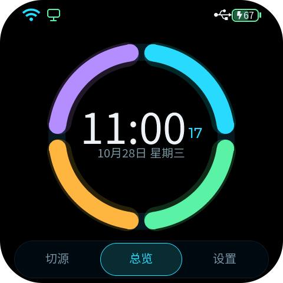
  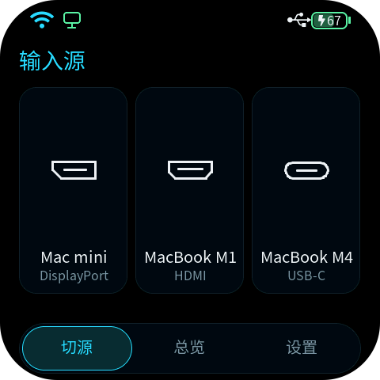
  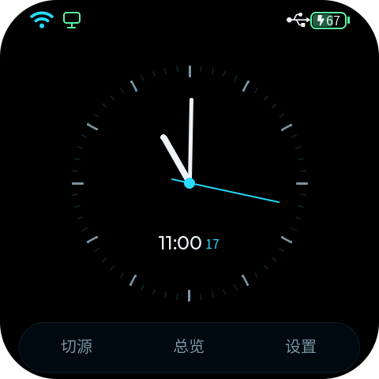

  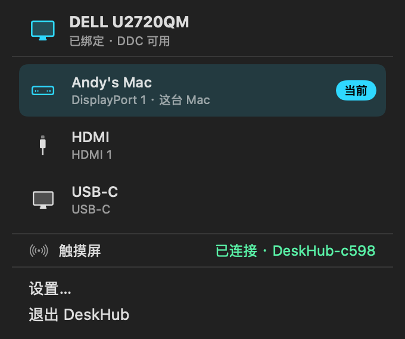

---

## 目录

- [截图](#截图)
- [它怎么工作](#它怎么工作)
- [下载和安装](#下载和安装)
- [日常使用](#日常使用)
- [固件更新](#固件更新)
- [安全设计](#安全设计)
- [现在能用什么](#现在能用什么)
- [常见问题](#常见问题)
- [更多文档](#更多文档)

---

## 截图

设备截图由真实的界面代码渲染（`firmware/tests/ui_preview`，和设备上跑的是同一套 LVGL 代码）。App 截图由 App 自己渲染（`DeskHub --screenshots`），用的是真实数据。

### 触摸屏

| 总览 | 总览：有消息时 | 圆环说明 |
| --- | --- | --- |
|  | 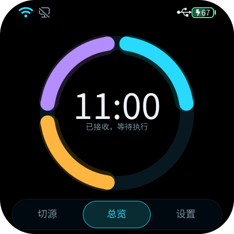 | 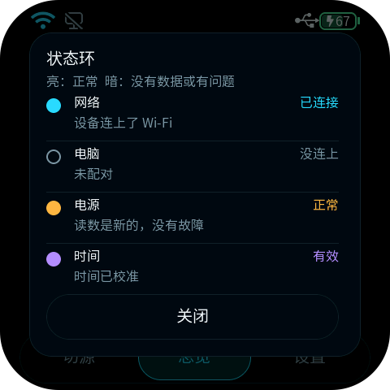 |
| **切源：列表** | **切源：图标** | **蓝牙配对：核对数字** |
| 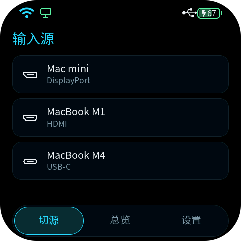 |  | 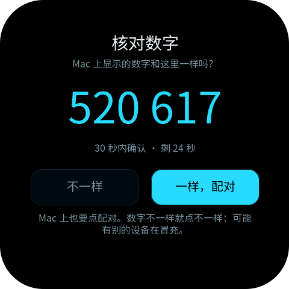 |
| **时钟：表针** | **时钟：大数字和秒** | **设置** |
|  | 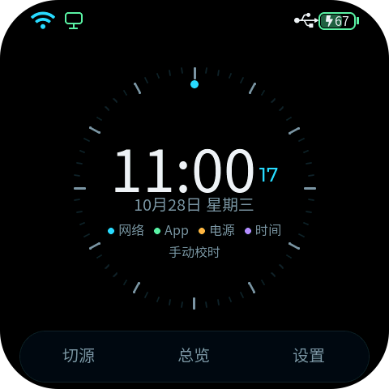 | 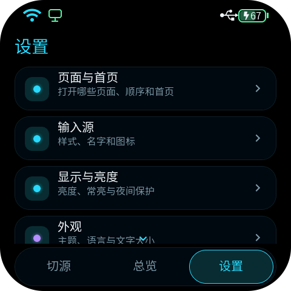 |
| **外观：秒和表针** | **电池与电源** | **连接与配对** |
| 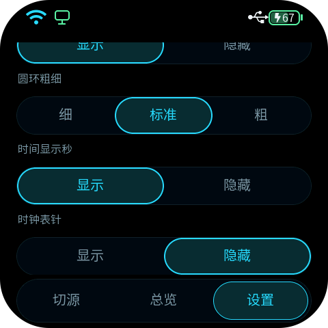 | 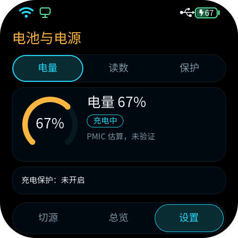 | 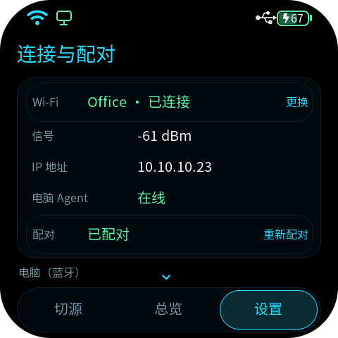 |
| **输入源的名字和图标** | **日期与时间** | **屏幕键盘（更换 Wi-Fi）** |
| 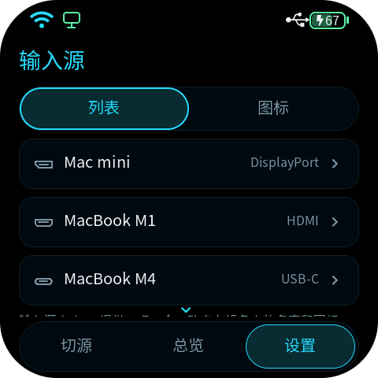 | 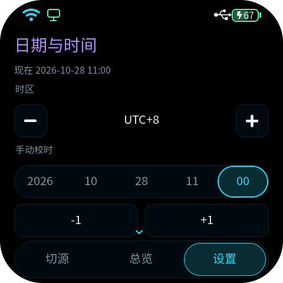 | 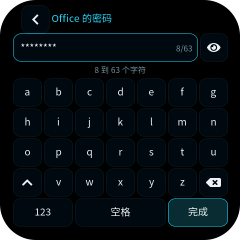 |
| **用量（Magpie）** | **用量：数据过期** | |
| 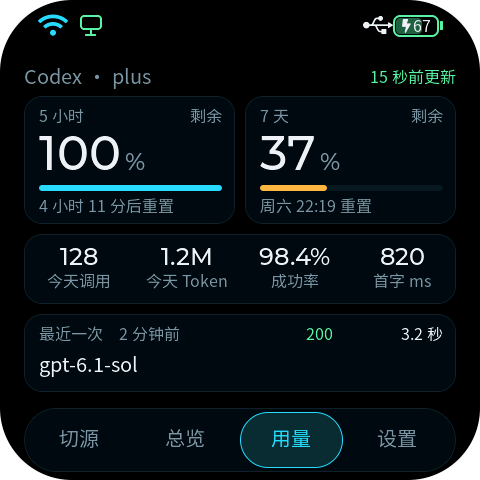 | 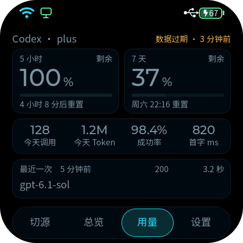 | |
| **主题：深海蓝** | **主题：暖橙** | **English，大字号** |
| 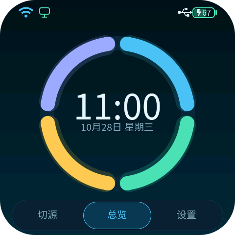 | 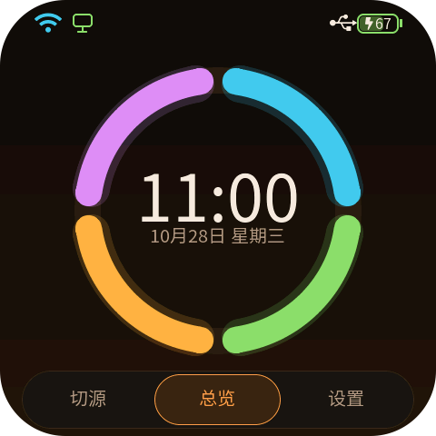 | 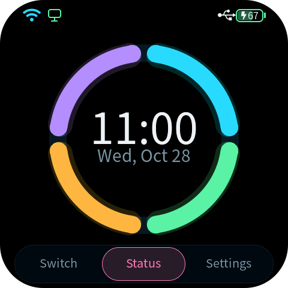 |

### 桌面 App

| 菜单栏 | 设置 · 显示器 |
| --- | --- |
|  | 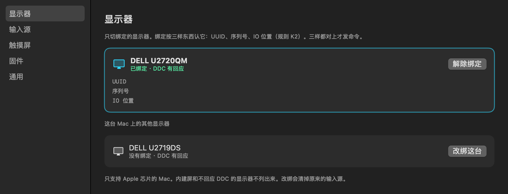 |
| **设置 · 输入源** | **设置 · 触摸屏** |
| 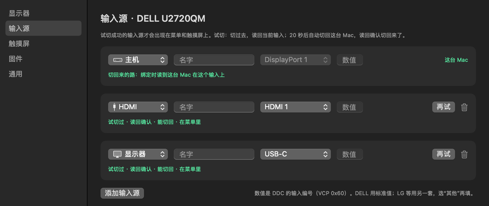 | 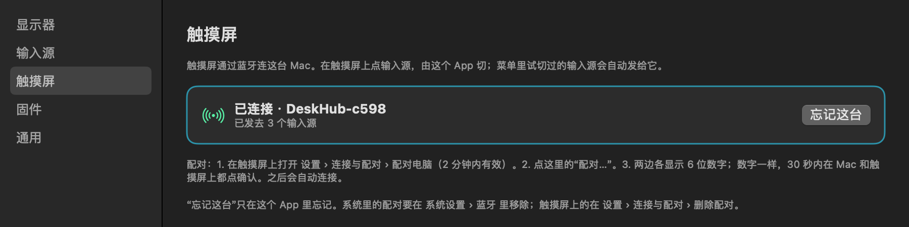 |

**设置 · 固件（USB 刷机和蓝牙升级）**

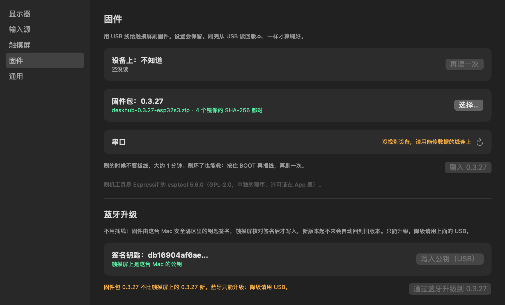

“显示器”页上显示器的 UUID、序列号和 IO 位置已经涂掉。

---

## 它怎么工作

### 系统架构

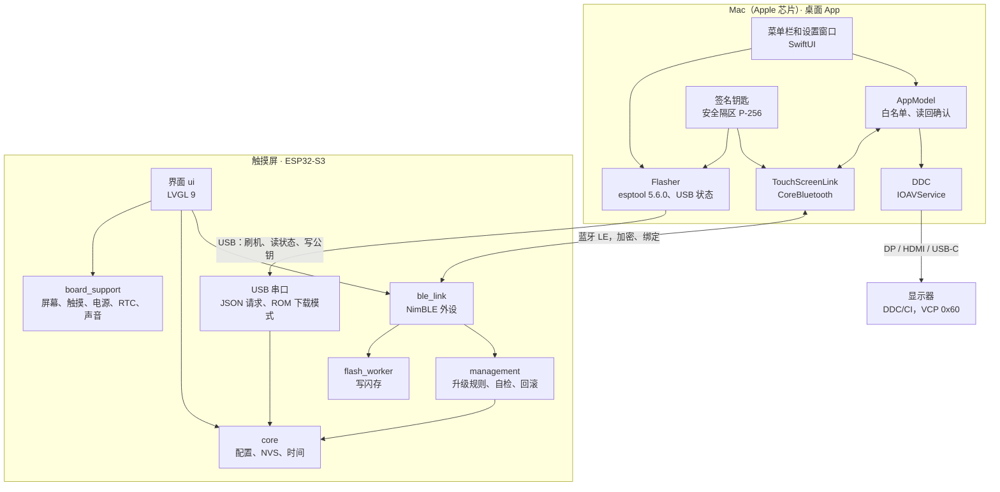

### 一次切源

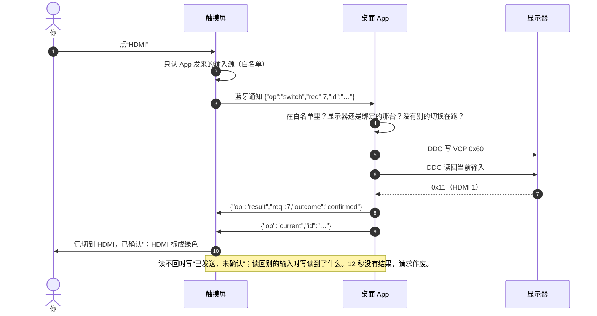

### 第一次配对（蓝牙）

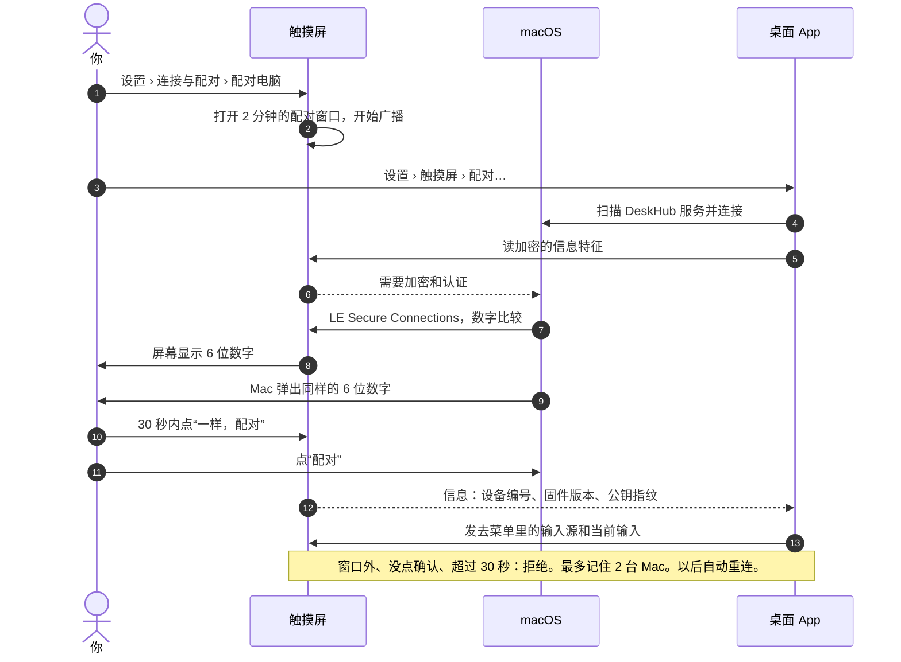

---

## 下载和安装

### 1. 装 App

1. 从 [Release](https://github.com/aimuch/DeskHub/releases/latest) 下载 `DeskHub-<版本>.dmg` 或 `.zip`。
2. 把 DeskHub 拖进“应用程序”（ZIP 解开就是 `DeskHub.app`，也可以拖进启动台）。
3. 第一次打开：在 Finder 里**右键 → 打开**。App 只有 ad-hoc 签名，没有经过 Apple 公证。
4. macOS 问蓝牙权限时，点“允许”。每次更新 App 后，macOS 可能会再问一次。

App 在菜单栏里，没有 Dock 图标（打开设置窗口时才有）。

### 2. 绑定显示器、试切输入源

1. 菜单栏 → **设置… → 显示器**：在要切的显示器上点“绑定”。App 记下它的 UUID、序列号和 IO 位置，三样都对上才发命令。
2. **输入源**：每个输入源选接口（DP1、DP2、HDMI1、HDMI2、USB-C、其他），点“试切”。App 切过去、读回，20 秒后切回这台 Mac、再读回。
3. 试切成功的输入源才会出现在菜单和触摸屏上。

### 3. 给触摸屏刷固件（第一次）

触摸屏出厂没有 DeskHub 固件时，用 USB 刷：

1. 从 Release 下载 `deskhub-<版本>-esp32s3.zip`。
2. 用能传数据的 USB-C 线连上触摸屏。
3. App → **设置 → 固件**：选固件包，选串口，点“刷入”。大约 1 分钟。
4. App 刷完会从 USB 读回版本，一样才写“已刷入（读回确认）”。

刷坏了也能救：按住 BOOT 再插线，进下载模式，再刷一次。

### 4. 配对触摸屏

1. 触摸屏：**设置 → 连接与配对 → 配对电脑**（2 分钟内有效）。
2. App：**设置 → 触摸屏 → 配对…**
3. 两边各显示 6 位数字。数字一样，30 秒内两边都点确认。

之后触摸屏的“切源”页会出现菜单里的输入源，当前的输入源是绿色。

---

## 日常使用

### 在触摸屏上

- **底部按钮** 是你打开的页面，最后是**设置**。默认是 **切源、总览、设置**。在“设置 → 页面与首页”里开关和排序；第一个打开的页面是首页。
- **顶栏全是图标。** 左边：Wi-Fi 和电脑，有斜杠表示没连上。右边：USB 和电池，电池里的数字是电量，充电时有闪电。点左边进“连接与配对”，点右边进“电池与电源”。
- **切源**：点一个输入源就切过去。当前的输入源是绿色，标“当前”；再点它不会发命令。样式在“设置 → 输入源”里选：列表或图标。在那里也能改它在触摸屏上的名字和图标。
- **总览**：大圆环和时间、日期。圆环四段：右上青色 = 网络，右下绿色 = 电脑，左下橙色 = 电源，左上紫色 = 时间；亮表示正常。点时间进时钟，点圆环看每一段的说明。错误、升级进度和切源结果会暂时代替日期显示在圆环里。
- **用量**（默认隐藏，在“设置 → 页面与首页”里打开）：本机 Magpie 的额度窗口剩多少、什么时候重置，今天的调用数、Token、成功率、首字延迟，最近一次请求。App 每 15 秒发一次；60 秒没收到写“数据过期”；Magpie 没开写“Magpie 没有运行”。最多同时打开 4 个页面。
- **待办**（默认隐藏，在“设置 → 页面与首页”里打开）：Mac 提醒事项里未完成的待办，分成已过期、今天、以后、没有日期，最多 30 条；今天的用强调色的标签标出。点一下选中，看全标题、清单和时间；长按弹出“完成 / 推迟到明天 / 删除…”，删除要再点一次。App 每 30 秒发一次；2 分钟没收到写“数据过期”，不能操作。设备字库没有的字显示成“?”。
- **时钟**：默认是表针，也可以换成大数字。在“设置 → 外观”里选“时钟表针”和“时间显示秒”。
- **设置**：页面与首页、输入源、显示与亮度、外观（主题、强调色、语言、字号、电池百分比、圆环粗细、秒、表针）、连接与配对、电池与电源、声音、桌面时钟、日期与时间、设备信息（重启、恢复出厂）。
- 屏幕关了以后，第一次触摸只唤醒屏幕，不会触发按钮。

### 在 Mac 上

- **菜单栏**：点输入源就切。切的时候会读回确认；读不回写“已发送，未确认”。
- **设置 → 输入源**：改名字、图标、接口；“再试”重新试切；删除。
- **设置 → 通用**：开机自动启动；“在触摸屏上显示 Magpie 用量”（默认开，只读本机 127.0.0.1:3425，不发 API Key、账号和请求内容）。“在触摸屏上显示待办（提醒事项）”（默认开；第一次会问提醒事项的权限）。

### 电池、声音、时间

- **电池与电源**：电量、电池和 USB 电压、芯片温度。**充电保护**（实验功能，默认关）：电量到上限就停充，低于回充线再充。
- **声音**：提示音默认关；音量三档；“试听”响一次。夜间限亮时段里不响。
- **日期与时间**：时区（默认 UTC+8，不处理夏令时），手动校时；联网后用网络时间。

---

## 固件更新

两种方式都在 App 的 **设置 → 固件** 里。

| | USB 刷机 | 蓝牙升级 |
| --- | --- | --- |
| 要插线吗 | 要 | 不要（第一次写公钥时要插一次） |
| 签名 | 不检查（插线等于能碰到设备） | 必须是这台 Mac 的钥匙签的 |
| 能降级吗 | 能（会先问你） | 不能，只能升级 |
| 用时 | 约 1 分钟 | 约 4 分钟（每秒约 20 KB） |
| 写完怎么确认 | 重启后从 USB 读回版本 | 重启后从蓝牙读回版本；60 秒自检不过就回到旧版本 |

### USB 刷机的流程

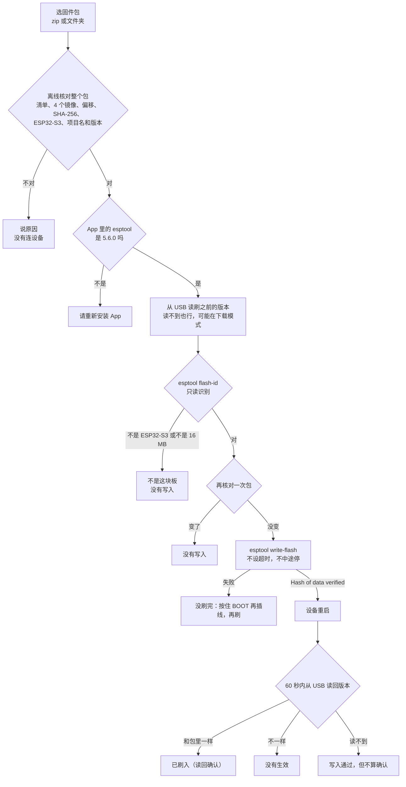

### 蓝牙升级的时序

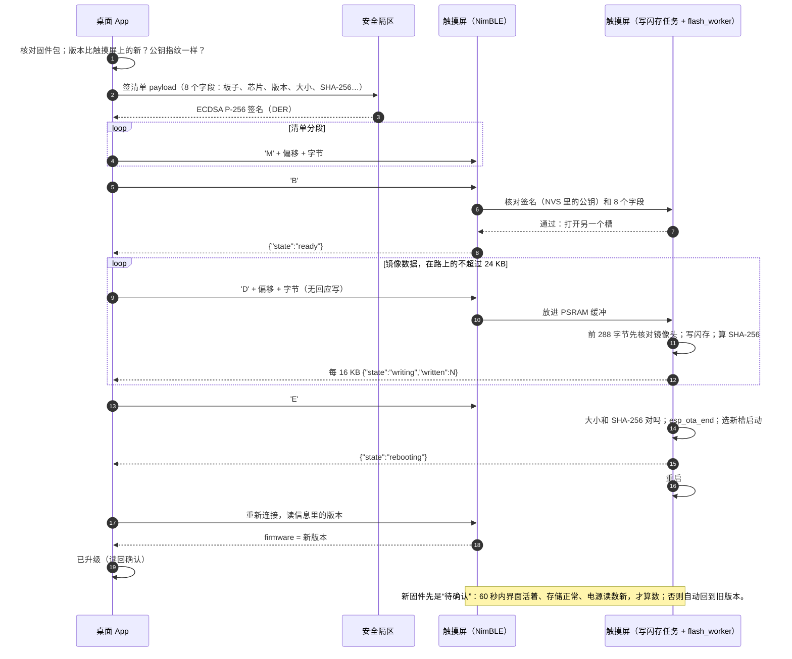

### 触摸屏上一次升级的状态

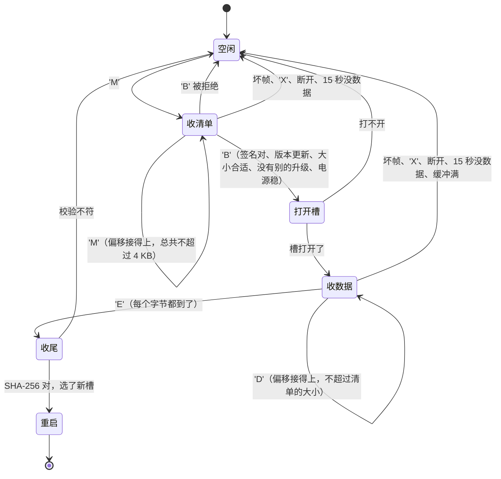

### 开机、自检和回滚

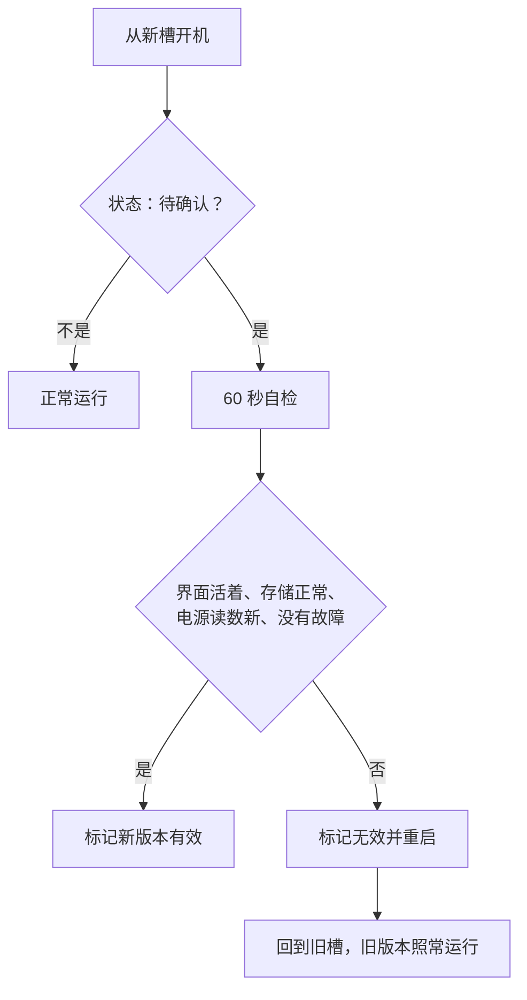

---

## 安全设计

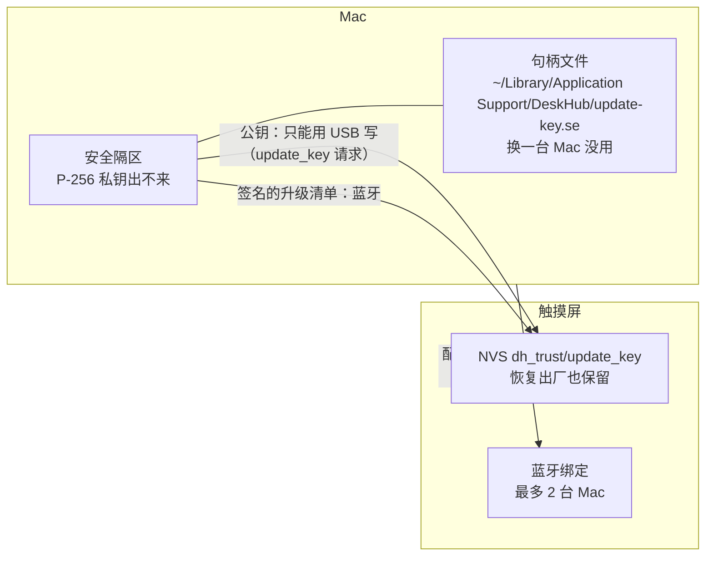

- **配对（K1）**：只有在“配对电脑”的 2 分钟里、并在屏幕上点了“一样，配对”，才接受新的 Mac。所有蓝牙特征都要加密并认证。
- **白名单（K2）**：触摸屏只发 App 给过的输入源；App 只切试切成功的输入源，只切绑定的那台显示器。一次只做一个切换。
- **读回确认（K3）**：只有读回和目标一样，才写“已确认”。
- **固件**：蓝牙升级必须是这台 Mac 的钥匙签的，只能升级，写完核对 SHA-256，新版本起不来自动回滚。公钥只能用 USB 写，蓝牙改不了。

规则的全文在 [docs/rules.md](docs/rules.md)。

---

## 现在能用什么

截至 2026-11-07，触摸屏固件 0.3.27，桌面 App 0.3.0。

| 功能 | 状态 |
| --- | --- |
| 菜单栏 App：绑定显示器、试切、从菜单切源 | 真机上绑定、试切、切换过，读回都确认。 |
| 触摸屏用蓝牙连 App 切源 | 真机上配对过，从触摸屏切了 10 次都读回确认；当前的源是绿色。 |
| App 用 USB 刷固件 | 真机上用同一段代码刷过 0.3.21 到 0.3.26，每次读回确认。 |
| App 用蓝牙升级固件 | 真机上写入、重启、读回都成功（约 4 分钟）；中途断开时旧固件照常运行。**但 0.3.28 以前，从蓝牙装上的版本从来没通过开机自检，下次复位就回到旧版本**（原因和修法见设计文档 13.11 U16）。0.3.29 修了自检；0.3.30 再修一个竞态：重启后马上读 info 会误报“已确认”（U18）。2026-11-11 真机验证：0.3.29 复位后留下，0.3.29 → 0.3.30 的蓝牙升级里 App 等了 64 秒才读到“自检通过”（`docs/evidence/firmware-0.3.30.json`）。签名不对、版本不新等拒绝路径只在主机测试里测过。 |
| 用量页（Magpie） | 固件 0.3.28、App 0.4.0：主机测试、界面测试、变异检查都过了；**还没在真机上看过**。 |
| 待办看板（提醒事项） | 固件 0.3.31、App 0.4.2 在真机上：列表显示、长按弹出操作。“完成”是否改到 Mac 还没试。 |
| 待办：更改和响铃 | 固件 0.3.32、App 0.4.3：主机测试、界面测试、App 检查都过了；**还没在真机上看过**。 |
| 触摸屏界面（总览、切源、时钟、设置、外观、电源、连接、声音、时间） | 已在设备上。0.3.21 起总览是大圆环；秒和表针可选（0.3.19）。 |
| 屏幕键盘更换 Wi-Fi | 0.3.13 起在设备上，USB 读回 Wi-Fi 已连接；失败回退没有完整验证。 |
| 充电保护（实验功能，默认关） | 0.3.6 在真机上停过一次充；**降到回充线以下再恢复充电，还没有验证**。 |
| 声音（提示音，音量三档） | 你听到过试听音；三档还没有人逐个听过。 |
| 时区、手动校时 | 在设备上，还没有在屏幕上试。 |
| Agent 路线（Wi-Fi + HTTPS + BetterDisplay，网页管理台） | 代码在，见 [docs/agent-setup.md](docs/agent-setup.md)。现在推荐用 App。 |

详细的范围和决定在 [产品范围](docs/product-scope.md)，每一版的证据在 [docs/evidence/](docs/evidence/)。

---

## 常见问题

**App 打不开，说“无法验证开发者”。** 在 Finder 里右键 DeskHub → 打开，再点“打开”。

**App 一直显示“没有配对”或连不上，可设备就在旁边。** 看看 macOS 有没有在问蓝牙权限：系统设置 › 隐私与安全性 › 蓝牙，把 DeskHub 打开。更新 App 后可能要再允许一次。

**固件页写“没找到设备”。** 换一根能传数据的 USB 线，关掉别的串口工具，点串口旁边的刷新。还不行：按住 BOOT，插 USB，松开 BOOT，再刷新。

**蓝牙升级说“触摸屏上没有这台 Mac 的公钥”。** 插上 USB，在固件页点“写入公钥（USB）”。删掉了 `update-key.se`，或者换了一台 Mac，都要重新写一次。

**蓝牙升级说“不比触摸屏上的新”。** 蓝牙只能升级。要降级，用上面的 USB 刷机。

**切源后写“已发送，未确认”。** App 读不回显示器的当前输入。有的显示器在切走以后不回应 DDC；看一下屏幕是不是切过去了。

**刷机以后设备一直不充电。** 你可能带着“停充”状态刷了旧固件。刷回新固件，它启动时会恢复充电。刷 0.3.1 或更早的固件之前，先在“电池与电源 → 保护”里关掉充电保护（见 [docs/flashing.md](docs/flashing.md)）。

Agent 路线的问题（证书、地址、配对令牌）见 [docs/agent-setup.md](docs/agent-setup.md#常见问题)。

---

## 更多文档

| 文档 | 内容 |
| --- | --- |
| [桌面 App 设计](docs/desktop-app-design.md) | App、蓝牙协议、USB 刷机和蓝牙升级的设计、失败方式和真机结果（第 13 节） |
| [设计稿](docs/design/README.md) | 设备界面和 App 的设计稿与规则 |
| [规则](docs/rules.md) | 安全规则 K1 到 K7 |
| [产品范围](docs/product-scope.md) | 做什么、不做什么、每个功能的状态 |
| [刷机说明](docs/flashing.md) | 不用 App，用包里的 `flash.py` 刷；刷旧固件前的注意事项 |
| [Agent 路线](docs/agent-setup.md) | Python Agent、证书、网页管理台、BetterDisplay |
| [充电保护设计](docs/charge-protection-design.md) | 规则、失败方式和验证状态 |
| [开发笔记](docs/development.md) | 给改代码的人：构建、测试、变异检查、基线文件（K7） |
| [证据](docs/evidence/) | 每一版固件的构建、测试和真机记录 |

`.state/` 里存着签名私钥、凭据和 Agent 数据库，被 `.gitignore` 排除。**不要提交，也不要复制出去。**
